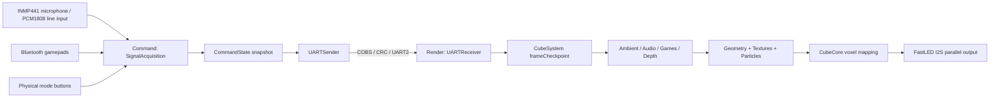

# Architecture and ownership

[Documentation index](../README.md) · [Data flow](DATA_AND_AUDIO.md)

## The two-board system

The command board is the input computer. The render board is the application
and display computer. They compile separate firmware and share the packet and
gamepad definitions in [`shared/`](../../shared/). They communicate over UART2;
USB serial is a separate human-readable diagnostic/programming interface.

| Owner | Work | Important boundary |
| --- | --- | --- |
| Command acquisition task, Core 1 | Buttons, source setup, PCM reads/analysis, Bluepad32 polling, publishing | Sole owner of acquisition and gamepad controller objects |
| Command sender task, Core 0 | Snapshot copies, bounded packet scheduling, encoding, Serial2 writes | Never holds state mutex during UART transmission |
| Render receiver task, Core 0 | Serial2 setup/read, parser, packet validation, input caches and pending events | Never renders, selects apps, advances musical time, or exits an app |
| Render Arduino/animation task, Core 1 | Frame snapshots, application dispatch, effects, geometry, all FastLED calls | Sole owner of playback and shared scratch arena |

Task placement and stack sizes live in `BoardConfig.h`,
`SignalAcquisition.cpp`, `UARTSender.cpp`, and `UARTReceiver.cpp`. Declared
stack sizes include 16,384 bytes for acquisition and 6,144 each for the sender
and receiver; they are not a complete RAM budget. Bluetooth has its own stack
on the command board. There is no Bluetooth pairing service on render.

## Startup and applications

Render [`main.cpp`](../../render-board/src/main.cpp) initializes USB Serial,
`initCube()`, and an unconditional wiring check (rainbow hold and swept
X-plane). `CubeSystem::setup()` then starts remote input, allocates scratch
memory, and launches registry entry 0, Ambient Art. Much of the remainder of
`main.cpp` is commented historical demonstration code; it is not the deck.

[`CubeSystem.cpp`](../../render-board/src/CubeSystem.cpp) owns the application
registry and three states: legacy-named boot diagnostics, menu, and running
app. The registry contains Ambient Art, Tetris 3D/2D, Asteroids 3D, Breakout
3D/2D, Snake 3D/2D, Rubiks, Diagnostics, Audio, and Depth Occupancy. The game
mode initially highlights Breakout 2D. The menu exposes games/diagnostics;
audio sources are chosen on the command board, not by the menu.

Every call to `showCube()` first calls `CubeSystem::frameCheckpoint()`. The
launcher also checkpoints between app calls. This freezes the next input
snapshot and acts on a new command `(session, revision)` exactly once. A
heartbeat with the same pair does not restart the app. Another press of the
active Animation button means Next. Another press of the active audio-source
button advances the audio visual while keeping capture running. Switching
sources or rebooting the command board selects/restarts the current visual
rather than treating it as Next.

Applications run ordinary C++ loops. Mode changes throw `AppExit::ModeChanged`
on the render task when `teleportArmed` is set; a held gamepad System/Home
button in Game mode can throw `AppExit::Home` after 500 ms. `handleApp()` catches
the exception at the launcher boundary. This unwinds local objects. Do not
restore `setjmp/longjmp`: it bypasses the required C++ cleanup. The legacy
`teleportArmed` name remains; it is an exception guard, not a jump buffer.

Never hold a receiver mutex or invoke FastLED from another task when exiting
an app. A routine that stops calling `showCube()` also stops servicing these
frame checkpoints; long calculations must remain bounded.

## Playback is separate from drawing

[`TestDemo.cpp`](../../render-board/src/TestDemo.cpp) owns ambient concept IDs,
names, enabled rules, weights, ordered list, motion/render permissions, and
dispatch. [`TestDemoAudio.cpp`](../../render-board/src/TestDemoAudio.cpp) owns
the independent audio list and remembered selection. Effects belong in their
family files, not in a second playlist hidden inside an effect.

The ambient default is descending ordered playback, with development
`animationHoldUntilNext() = true`. Holding a card keeps animation running.
The audio default is descending, 30 seconds per card; duration 0 means manual
Next only. The command Depth button currently toggles a separate playback-Hold
latch for both playlists. Hold suppresses automatic completion; it does not
freeze motion, input, or manual navigation. Source/mode changes preserve deck
selection while cancelling the old active timer.

Ordered ambient Next is valid both inside a scene and between app calls.
The latter path was fixed at this checkpoint: requiring an active drawing
flag there could restart the same slot with a new palette. Box has deliberate
intra-card texture steps; those must survive changes to cursor handling.

## Memory and pacing

[`AppMemory.h`](../../render-board/src/AppMemory.h) defines a fixed 8,192-byte
scratch arena, allocated once by `initAppMemory()`. Apps reuse it sequentially.
Allocation failure aborts startup. Canvas changes do not enlarge it. There is
a compile-time bound for one-byte-per-voxel scratch maps.

Particle pools are typed views into this arena; capacity is
`8192 / sizeof(record)`, clamped by the requested population. Do not allocate
two independent live pools over the same memory or retain a view after a
scene returns. Stack locals, static buffers, LED arrays, task stacks, DMA,
and Bluetooth memory are additional allocations outside this arena.

`showCube()` caps transmission starts at approximately 60 Hz (16,667 µs).
Drawing, LED transfer, task scheduling, and effect-local intervals can lower
the achieved rate. Audio analysis, packet transmission, particle simulation,
and display frames run on distinct clocks. “60 Hz” is a ceiling, not a promise
of 60 fully rendered frames per second.

## Source map

| Layer | Files |
| --- | --- |
| Capture and analysis | `command-board/src/SignalAcquisition.cpp`, `AudioAnalysis.h`, `AttackDetector.h`, `TempoTracker.h` |
| Command state / input | `CommandState.*`, `ModeButton.h`, `BluetoothManager.*`, `SourceAdapters.*` |
| Transport | `shared/SharedProtocol.h`, `shared/GamepadState.h`, `UARTSender.*`, render `UARTReceiver.*` |
| Application lifecycle | Render `main.cpp`, `CubeSystem.*`, `AppMemory.*` |
| Playback | Render `TestDemo.*`, `TestDemoAudio.cpp` |
| Graphics infrastructure | `CubeCore.*`, `GeometryEngine.h`, `TextureEngine.h`, `WledPalettes.*`, `ParticleEngine.h`, `ParticleEffectSupport.h` |
| Effects | `Shapes.h`, `Planes.h`, `Surfaces.h`, `Streamers.h`, `Swirls.h`, `Explosions.h`, `Boxes.h`, `Balls.h`, `Patterns.h`, `Flows.h`, `EyeOfSauron.h` |
| Audio renderers | `Audio.*`, `AudioShapes.cpp`, `AudioFrame*`, `MidrangeBoost.h`, `BpmRenderer.h`, `JuliaRenderer.h`, `ParticleEffects.*` |
| Text / icons / games | `Letters.*`, `Icons.*`, `Hebrew.h`, `Games/` |

File paths without a directory in this table are relative to the stated board's
`src/`. Source links and the catalog identify the active entry points.
